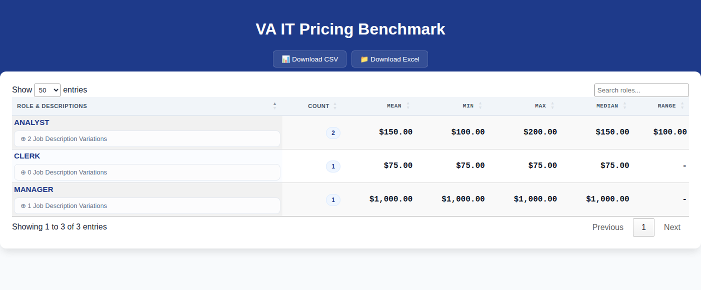
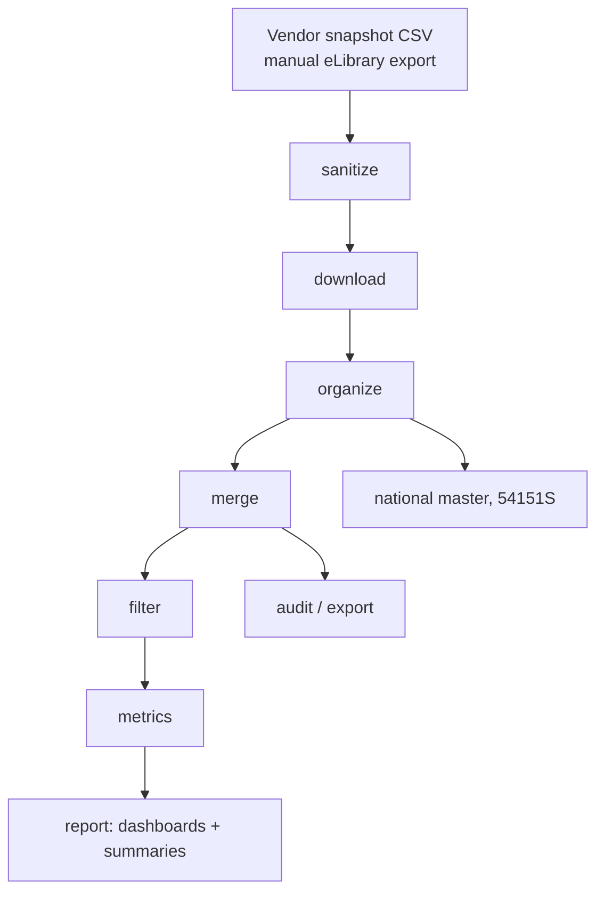

# gsa-vendor-toolkit

[](https://github.com/enonymous1/gsa-vendor-toolkit/actions/workflows/ci.yml)

You have a GSA schedule vendor list and hundreds of published price lists.
This turns them into per-title pricing metrics, interactive dashboards, and
executive summaries — one command per stage, from a vendor snapshot CSV to a
report you can open in a browser.



GSA vendor price-list pipeline, refactored from the original `ss-gsaVendors`
scripts into an installable, maintainable Python package (`vendors_toolkit`).

## Why

The original workflow was 20 organically grown scripts, each duplicating the
next, with silent disagreements (retries, copy-vs-move, dashboard page
length) hidden in the copies. This package unifies them into one tested
pipeline: the same engines for both variants, the drift captured explicitly in
`config.py`, and differential tests proving the new outputs match the
originals byte-for-byte where they should — and fixing the places where the
originals were quietly wrong (see Behavioral notes).

## Non-goals

- **Not a vendor-data fetcher.** The vendor snapshot CSV comes from a manual
  GSA eLibrary export (see Step 0); eLibrary has no public API, and this tool
  does not scrape it.
- **Not a live price monitor.** It analyzes a snapshot, not a feed. Re-run it
  when you have a new export.
- **Not a SAM.gov replacement.** The SAM.gov client is an optional enrichment
  scaffold (entity lookup, exclusion screening); the pipeline works without it.
- **Not a web service.** No server, no API, no scheduler — a CLI you run when
  you need a report.

## Try it in 2 minutes

The repo ships a small fictional dataset (`sample-data/`) so you can run the
whole pipeline without a real GSA export:

```bash
git clone https://github.com/enonymous1/gsa-vendor-toolkit.git
cd gsa-vendor-toolkit
pip install -e .
cp -r sample-data demo          # sample-data stays pristine; work in demo/
vendors-toolkit --root demo sanitize
vendors-toolkit --root demo organize
vendors-toolkit --root demo merge --states VA
vendors-toolkit --root demo filter --states VA
vendors-toolkit --root demo metrics --states VA
vendors-toolkit --root demo report --states VA
open demo/output/reports/VA_IT_Pricing_Full_Report.html
```

(`download` is skipped here because the sample price lists are already in
place; `national`, `audit`, and `export` are optional stages — see below.)

**Pipeline:** download vendor price lists → organize by State/City → merge Excel
"Price List" sheets into per-state master CSVs → filter by SIN → compute per-title
pricing metrics → audit / export → build the national master → generate HTML
dashboards and Markdown executive summaries.

Two pipeline variants share the engines: **54151S** (IT services) and **541611**
(management consulting). Where the original script twins disagreed (retries,
copy-vs-move, dashboard page length, …), the drift is captured explicitly in
`config.py` rather than hidden in duplicated code.

## Layout

```text
gsa-vendor-toolkit/
├── .github/workflows/ci.yml       # pytest + ruff + mypy on Python 3.10–3.12
├── pyproject.toml                 # packaging, ruff + mypy-strict, `vendors-toolkit` entry point
├── sample-data/                   # fictional dataset for the 2-minute quick start
├── docs/dashboard-preview.png     # screenshot of the generated dashboard
├── src/vendors_toolkit/
│   ├── __init__.py
│   ├── cli.py                     # `vendors-toolkit` subcommands (one per stage)
│   ├── config.py                  # centralized frozen-dataclass configuration
│   ├── logging_config.py          # idempotent stdlib logging
│   ├── data/                      # GSA_MAP, sanitize_frame, title/price cleaning helpers
│   ├── pipeline/                  # sanitize, download, organize, merge, filter, national
│   ├── analysis/                  # metrics, audit + cardinality, exports, unique titles
│   ├── reporting/                 # HTML dashboards + executive summaries
│   └── integrations/              # SAM.gov API client (scaffold; needs SAM_API_KEY)
├── tools/export_to_md.py          # standalone .py → Markdown exporter (unchanged)
├── original/                      # pristine copies of the 20 original scripts (reference only)
└── tests/                         # pytest suite (62 tests)
```

## Install

```bash
pip install -e .          # runtime (+ `vendors-toolkit` on PATH)
pip install -e ".[dev]"   # + pytest, ruff, mypy, pandas-stubs
```

## Usage

```bash
# project root: --root, else $VENDORS_ROOT, else the working directory
vendors-toolkit --root /data/vendors --variant 54151S sanitize
vendors-toolkit --root /data/vendors --variant 541611 download --limit 100
vendors-toolkit --root /data/vendors merge --states VA DC
vendors-toolkit --root /data/vendors filter --variant 54151S --states VA
vendors-toolkit --root /data/vendors metrics --states VA DC National
vendors-toolkit --root /data/vendors national --variant 54151S
vendors-toolkit --root /data/vendors report --states VA National
vendors-toolkit --help            # global options
vendors-toolkit download --help   # per-stage options
```

Stages run in pipeline order: `sanitize → download → organize → merge → filter →
metrics → audit → export → national → report`. `--variant` accepts `54151S`,
`541611`, or `all` (default). Logging: `--log-level`, `--log-dir` (rotating DEBUG
file), or the `VENDORS_LOG_LEVEL` env var.

## Worked example

From the sample data: two Virginia vendors, three job titles. After `merge`,
`filter`, and `metrics`, `VA_IT_Role_Metrics.csv` holds:

```csv
Title_Key,Count,Min_Price,Max_Price,Mean_Price,Median_Price,Mode_Price,Merged_Descriptions,Price_Range
ANALYST,2,100,200,150.0,150.0,100,Does analysis | More analysis,100
CLERK,1,75,75,75.0,75.0,75,,0
MANAGER,1,1000,1000,1000.0,1000.0,1000,Manages,0
```

And `report` turns it into an executive summary:

```markdown
# IT Pricing Executive Summary: VA

- **Total Unique Roles**: 3

## 🏆 Top 10 Roles by Frequency
| Job Title | Count | Mean Price |
| :--- | :---: | :---: |
| ANALYST | 2 | $150.00 |
| CLERK | 1 | $75.00 |
| MANAGER | 1 | $1,000.00 |
```

plus the full interactive dashboard (searchable, sortable, filterable) shown
at the top of this README.

## Pipeline / workflow



### Step 0 — Get the input file (the pipeline does not fetch this itself)

The pipeline starts from a **vendor snapshot CSV**: one row per vendor, with at
least these columns: `Vendor`, `Contact #`, `Price List` (the URL of the
vendor's published price list), `Category`, `State`, `City`,
`Has_Price_List_Flag`.

Where it comes from: **GSA eLibrary** (gsaelibrary.gsa.gov) — search by SIN
(54151S = IT Professional Services; 541611 = management consulting) or by
contractor name, and export/save the vendor listing as a CSV. eLibrary has no
public API, so this step is a manual export, not a download stage.

Where it goes: `ext_res/` under the configured name — `2026_02_12_04_10_24.csv`
for 54151S, `2026_03_02_08_18_31.csv` for 541611 (those dated names are just
the snapshots the config was built with; rename your export to match, or pass
`--input` to `sanitize` to use another file).

<details>
<summary>Stages and their outputs (under <code>output/</code>)</summary>

| Stage | Reads | Writes |
| --- | --- | --- |
| `sanitize` | `ext_res/<raw CSV>` | `ext_res/<sanitized CSV>` |
| `download` | sanitized CSV's `Price List` URLs | `downloads/<price lists>`, `summaries/<manifest>` |
| `organize` | downloads dir | `downloads/<by_region>/<STATE>/<City>/` |
| `merge` | organized workbooks' `"Price List"` sheets | `<analysis>/<STATE>_Master_Price_List.csv` |
| `filter` | merged masters | `merged_filtered/<STATE>_SIN_<SIN>_Only.csv` |
| `metrics` | filtered files (54151S) / merged files (541611) | `<metrics>/<STATE>_<..._Metrics.csv` (+ xlsx) |
| `audit` | sanitized CSV, merged masters | `output/audit_summary.md`, `column_selections/*.json` |
| `export` | sanitized CSV | `price_lists/`, `regional/<STATE>/`, `summaries/*.md` |
| `national` | manifest + sanitized CSV + organized workbooks (54151S) | `merged_national/National_IT_Master_Price_List.csv` |
| `report` | metrics CSVs | `<reports>/<STATE>_*_Full_Report.html`, `*_Executive_Summary.md` |

</details>

The `download` stage is plain HTTP file fetching (`requests.get` per `Price
List` URL, with retries) — there is no API behind the price lists. The
`national` stage re-reads the organized workbooks through the download
manifest; it does not concatenate the merged state files.

### SAM.gov enrichment (scaffold, optional)

`integrations/samgov.py` wires the free SAM.gov APIs for future vendor
enrichment (entity lookup by UEI/CAGE, exclusion screening, opportunity
search). It is inert until a key exists:

```bash
# free key: SAM.gov account → Account Details → "Public API Key"
export SAM_API_KEY="SAM-..."
vendors-toolkit sam --status          # check configuration, no API call
vendors-toolkit sam --uei <UEI>       # entity lookup
vendors-toolkit sam --uei <UEI> --excluded   # exclusion check
vendors-toolkit sam --keywords "IT services" --naics 54151S
```

Free tiers: 10 requests/day with a basic account, 1,000/day with a SAM entity
role. Keys expire every 90 days. The `sam` command runs once per invocation
(not per variant) so it never double-spends the daily budget.

## Configuration

`config.py` holds every knob the originals hardcoded: paths, download
retries/timeouts/workers, merge sheet matching, metrics filenames, dashboard CDN
URLs, and the per-variant drift (`VariantConfig`). All dataclasses are frozen.

## Behavioral notes (deliberate fixes vs the originals)

- Missing input files raise `FileNotFoundError` instead of printing and continuing.
- Missing titles normalize to `""` (the IT analyzer emitted `"NONE"`/`"None"`).
- Price cleaning strips `$`/commas on every pandas version — the IT analyzer's
  `dtype == object` check silently dropped `$`-prices on pandas 3.
- Dashboard descriptions are HTML-escaped (the originals injected raw markup).
- The 54151S downloader no longer crashes keying futures on an unhashable Series.
- Both mergers match the `"price list"` sheet exactly (case-insensitive).

## Quality gates

```bash
ruff check src/ tests/ && ruff format --check src/ tests/
mypy src/          # strict
pytest             # 57 tests
```

Differential tests proving byte-level behavioral parity with `original/` were run
per phase during the refactor (see the git history: phases 3–7).
